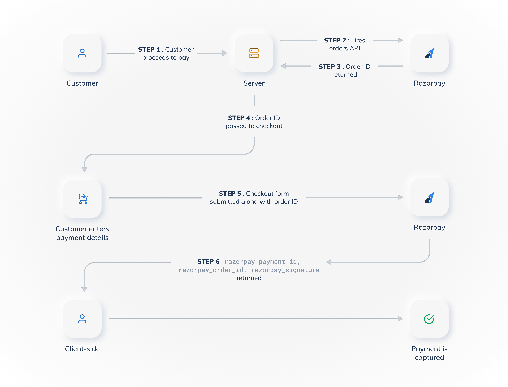

# Razorpay

Razorpay Payment Gateway is a full-stack financial solutions company and payment gateway in India that lets websites and apps accept payments via UPI, credit/debit cards, netbanking, and digital wallets

## Documentations

- [Razorpay Documentations](https://razorpay.com/docs/home)
- [Razorpay Integrations](https://razorpay.com/integrations)
- [Razorpay API reference](https://razorpay.com/docs/api)
- [Payment gateway workflow](https://razorpay.com/docs/payments/payment-gateway/how-it-works)

## Workflow



## Create a New Node JS Project

1. Create a new Node.js project inside a folder.

```sh
mkdir razorpay-node-integration
cd razorpay-node-integration
```

2. Initialize a new Node.js project

```sh
pnpm init
```

3. Installing Dependencies

```sh
pnpm i express razorpay dotenv
```

4. Create an order using Orders API in the server

Let us use Razorpay Orders API to create an order.

Create an Express server.
Set up a basic server configuration with routes to handle payment requests.

Create a new file named `server.js` in your project directory and integrate orders API

```js
require("dotenv/config");
const express = require("express");
const path = require("path");
const { validateWebhookSignature } = require("razorpay/dist/utils/razorpay-utils");
const { razorpay } = require("./config");

const app = express();
const PORT = process.env.PORT || 3000;

app.use(express.json());
app.use(express.urlencoded({ extended: true }));
app.use(express.static(path.join(__dirname)));

let DB = [];

app.post("/create-order", async (req, res) => {
  try {
    const { amount, currency, receipt, notes } = req.body;
    if (amount < 0 || !currency || !receipt) {
      return res.status(400).json({ error: "all fields are required and must be valid" });
    }

    const order = await razorpay.orders.create({
      amount: amount * 100, // Convert amount to paise
      currency,
      receipt,
      notes,
    });

    res.json(order);
  } catch (error) {
    console.error(error);
    res.status(500).send("Error creating order");
  }
});

app.get("/payment-success", (req, res) => {
  res.sendFile(path.join(__dirname, "success.html"));
});

app.listen(PORT, () => console.log(`server started at http://localhost:${PORT}`));
```

5. Add Razorpay Checkout Sample Code to frontend

Create a simple HTML page to accept user payment.
This page will have a pay button that will be used to trigger the payment process.

Create `index.html` file. Next we will add the Razorpay checkout script and parameters.

```html
<!doctype html>
<html lang="en">
  <head>
    <meta charset="UTF-8" />
    <meta name="viewport" content="width=device-width, initial-scale=1.0" />
    <title>Razorpay Payment</title>
  </head>
  <body>
    <h1>Razorpay Payment Gateway Integration</h1>
    <form id="payment-form">
      <label for="amount">Amount:</label>
      <input type="number" id="amount" name="amount" required />
      <br />
      <br />
      <button type="button" onclick="payNow()">Pay Now</button>
    </form>

    <script src="https://checkout.razorpay.com/v1/checkout.js"></script>
    <script>
      const payNow = async () => {
        const response = await fetch("/create-order", {
          method: "POST",
          headers: { "Content-Type": "application/json" },
          body: JSON.stringify({
            amount: document.getElementById("amount").value,
            currency: "INR",
            receipt: "receipt##1",
            notes: { new: "note: test appplication" },
          }),
        });

        const order = await response.json();

        const rzp = new Razorpay({
          key: "rzp_test_Thkmm5wvasoRq6",
          amount: order.amount,
          currency: order.currency,
          name: "Your Company Name",
          description: "Test Transaction",
          order_id: order.id,
          callback_url: "http://localhost:3000/payment-success",
          prefill: {
            name: "Your Name",
            email: "your.email@example.com",
            contact: "9999999999",
          },
          // theme: { color: "##F37254" },
          handler: async (response) => {
            try {
              const result = await fetch("/verify-payment", {
                method: "POST",
                headers: { "Content-Type": "application/json" },
                body: JSON.stringify({
                  razorpay_order_id: response.razorpay_order_id,
                  razorpay_payment_id: response.razorpay_payment_id,
                  razorpay_signature: response.razorpay_signature,
                }),
              });

              const data = await result.json();
              if (data.status !== "ok") alert("Payment verification failed");
              else window.location.href = "/payment-success";
            } catch (error) {
              console.error("Error in : ", error);
              alert("Error verifying payment");
            }
          },
        });
        rzp.open();
      };
    </script>
  </body>
</html>
```

6. Start application

```sh
pnpm dev
```

7. Test the Integration

Let's test the payment integration by making a test payment on the application.
We'll use the test card details provided by Razorpay for testing purposes.

8. Verify Payment Status

Go to Razorpay Dashboard > Transactions > Payments section

- Log in to the Razorpay Dashboard.
- Navigate to Transactions -> Payments.
- Click the Payment id to view and confirm the transaction details.

9. Go Live

Congratulations! Our payment integration is working smoothly in the test mode. To accept payments in live mode and collect real-world payments, replace the Test API Keys with Live API Keys.

Ensure the KYC is complete for your account to accept and settle payments as per your Settlement Cycle.

You've successfully integrated the Razorpay payment gateway with your Node.js stack. You can now accept payments securely on your Node.js web application.
